<div align="center">

# KART

**A shopping cart that sees what you put in the basket, keeps a live bill on an iPad, and talks you through the trip.**

Built at CalHacks 13.0 (October 2026): edge computer vision on a Raspberry Pi, a Supabase backend with realtime, a native SwiftUI iPad app, a hosted voice agent with Claude tool use, and a chat console for the store owner.

[Architecture](#architecture) · [Demo walkthrough](#product-walkthrough) · [Engineering notes](#interesting-engineering) · [Getting started](#getting-started) · [System deep dive](docs/ARCHITECTURE.md) · [Integration contract](docs/CONTRACT.md)

[](LICENSE)
[](#status-and-limits)

<br/>

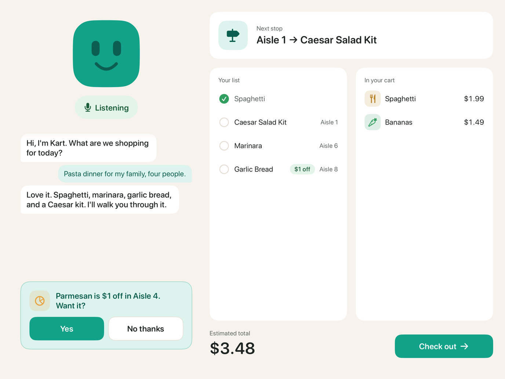

<sub>The cart's iPad mid-trip (iPad simulator, seeded scenario): the plan Kart made by voice, the live bill, and a deal offered at the moment of decision.</sub>

</div>

---

## What it does

Two webcams look down into the cart's basket. When something goes in or comes out, a Raspberry Pi works out what changed, names the product, and sends one event per unit to Supabase. Postgres reprices the cart, re-routes the shopping list and decides whether a deal or a quantity nudge applies, and the iPad on the handle redraws from the database within about a second. **Kart**, the cart's voice, plans the trip ("pasta night for my family of 4"), edits the list by voice, offers the deal that goes with what you just picked up, and points out when you have taken more than the meal needs.

The project is interesting less for any one model than for the coordination: six runtimes spread across a Raspberry Pi, an iPad, a laptop and three hosted services (Supabase, Cartesia, Anthropic), held together by one database and a written [integration contract](docs/CONTRACT.md).

## Core capabilities

| The cart sees what goes in and out (raw camera view, filmed in a store) |
| :--- |
| 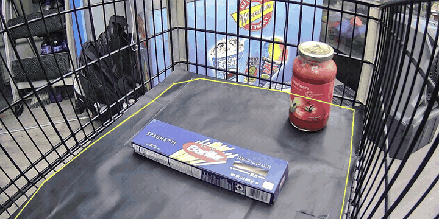 |
| One overhead camera watches the basket floor (yellow outline). When something lands and the hand is gone, the Pi diffs the settled frame against the last one, crops only what changed (the inset) and names it: first against photos taken at enrollment, then with Claude choosing from the store's own catalog. No model was trained, and nothing is scanned or tagged. More in [How the cart sees](#how-the-cart-sees). |

| Voice-planned, route-ordered trip | A live bill that only moves in your favour |
| :--- | :--- |
| 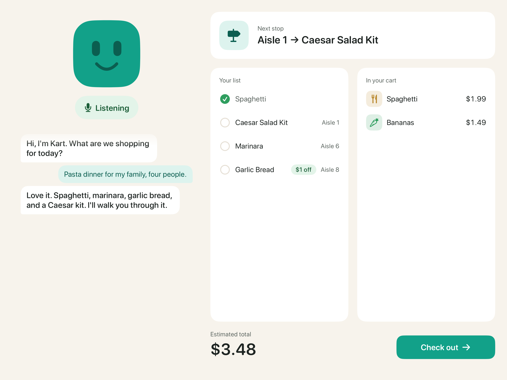 | 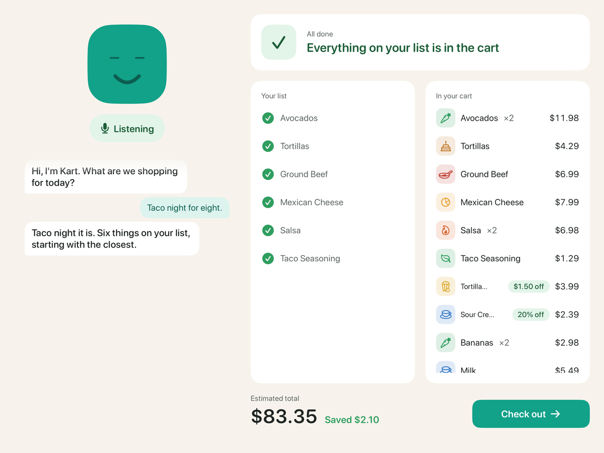 |
| Kart turns a meal into a list with quantities and a reason for each amount; the backend orders it by walking route and keeps "next stop" current as items go in. | Prices, deals and totals are computed in Postgres. A price drop or new deal reaches items already in the cart; an increase or an ended deal never does. |

| "Is this…?" when the camera is unsure | Member memory (beta, off by default) |
| :--- | :--- |
| 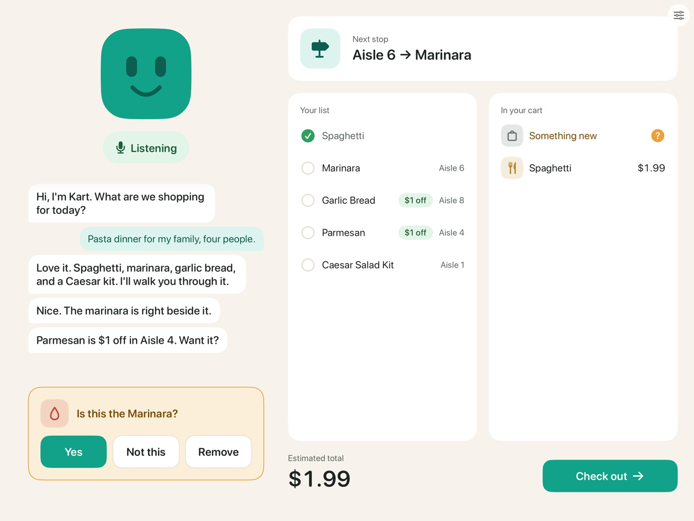 | 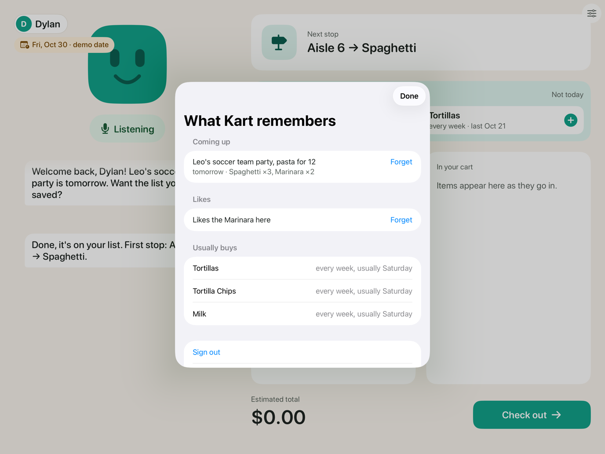 |
| An item the cart can't name is billed as unknown and shown as a one-tap question. Checkout is refused while any unknown is unresolved. | A signed-in member's events, saved lists and usual buys, captured in conversation, each with a one-tap Forget. Sign-in lasts one trip. |

<sub>All four captures are from the iPad simulator: `ios/scripts/shoot.sh` scenarios and the automated rehearsal in `ios/KartUITests/`.</sub>

Also in the build, without a screenshot yet:

| Capability | Where it lives |
| :--- | :--- |
| **Right amount for the meal.** A second box of spaghetti on a "pasta night for 4" list gets "That's two boxes of spaghetti in the cart, and pasta night for 4 needs one. Keep the extra?" Nudges compare the cart against the plan's `qty`, never impulse buys. | `recompute_cart` in [`backend/db/02_cart.sql`](backend/db/02_cart.sql), flag `quantity_nudges` |
| **Kart takes no for an answer.** One "No thanks" sets `carts.deals_quiet`: no more unprompted deal cards this trip, including deals the store creates later. Asking still works. | `dismiss_suggestion` in [`02_cart.sql`](backend/db/02_cart.sql), [`agent/kart_agent/agent.py`](agent/kart_agent/agent.py) |
| **Honest "not sold here".** An item outside the catalog gets an in-store stand-in or a nearby store that "might carry it", never a stock claim. | `not_sold_here` in [`agent/kart_agent/tools.py`](agent/kart_agent/tools.py), `store_info.nearby` |
| **Store-owner console.** "Spaghetti $1 off through Sunday" becomes a staged change with a plain-English preview; only the owner's Confirm applies it, and every change can be undone. | [`merchant/`](merchant/), `merchant_apply` in [`backend/db/05_merchant.sql`](backend/db/05_merchant.sql) |
| **Tap-to-pay checkout and receipt.** Receipt with savings and time in store. The terminal is a demo: nothing is charged. | [`ios/Kart/Features/Checkout/`](ios/Kart/Features/Checkout/), `checkout()` in [`backend/db/04_trip.sql`](backend/db/04_trip.sql) |

## Product walkthrough

The demo is one natural trip, scripted in [`docs/DEMO_PLAN.md`](docs/DEMO_PLAN.md) (final script, 2026-10-24). Props: three identical boxes of spaghetti, a jar of marinara, a Parmesan shaker and a pack of kids' scissors. The right-hand column is what each beat exercises underneath.

| # | Shopper | Kart and the cart | Under the hood |
| :-- | :--- | :--- | :--- |
| 1 | "Pasta night for my family of 4." Then "Not now" to the deals question. | Lists spaghetti, marinara and garlic bread; "First stop is Aisle 6." Deals wait for the shelf. | Claude tool loop → `set_plan`; backend orders by route |
| 2 | "We've got garlic bread at home, take it off." | "Took garlic bread off your list." | `remove_from_plan` (also retires its deals for the trip) |
| 3 | "Leo needs kids' scissors for school." | "Added a two-pack of kids' scissors, Aisle 9… we'll grab them last." | `add_to_plan`; nearest-aisle routing |
| 4 | Drops the **spaghetti**, says "Yes". | "Got the Spaghetti. Parmesan is $1 off in Aisle 4. Want it?" Route becomes 6 → 4 → 9. | CV → `apply_cart_event` → `suggestion` from `deals.pairs_with` → template line |
| 5 | Drops the **marinara**. "Add olive oil too." | "We don't carry olive oil, sorry. Trader Joe's, about a mile away, might have it." | `not_sold_here` tool, `store_info.nearby` |
| 5b | Drops a **second spaghetti** box beside the first, says "No", puts it back. | "That's two boxes of spaghetti in the cart, and pasta night for 4 needs one. Keep the extra?" → "Took the Spaghetti off your bill." | Over-quantity nudge; a removal event |
| 5c | *(member beta)* "Next Saturday is Leo's soccer team party, we'll need pasta for 12." | Remembers the party and saves a list: three spaghetti, two marinara. | `member_remember`, `member_save_for_later` |
| 5d | Drops the **Parmesan**. | The bill shows the struck-through price and "saved $1". | Deal pricing and `savings` in `recompute_cart` |
| 6 | Drops the **scissors**, takes them back out: "Yes, the school has some." | "Took the Kids' Scissors off your bill. Take them off the list too?" → off the list. | Removal → follow-up question → `remove_from_plan` |
| 7 | Taps **Check out**, then **Pay**. | Receipt with savings and time in store. "Paid. Enjoy pasta night!" | `checkout()` writes the receipt; `ui_action: paid` |
| 8–9 | *(Act 2, member beta)* Fast-forward to Friday, sign in, "Yes" to the saved list, drop all three boxes, "No thanks" to the Parmesan card. | "Leo's soccer team party is tomorrow. Want the list you saved?" No nudge (the party needs three) and no more deal cards. | `set_demo_date`, `shop_saved_list`, nudge reads plan `qty`, `deals_quiet` |

The team's last recorded live end-to-end run (real cart, real voice, tap-to-pay) billed the right total at checkout; one phantom item from a nudged jar had to be removed on the iPad ([`docs/STATUS.md`](docs/STATUS.md), 2026-10-25 00:40).

<p align="center">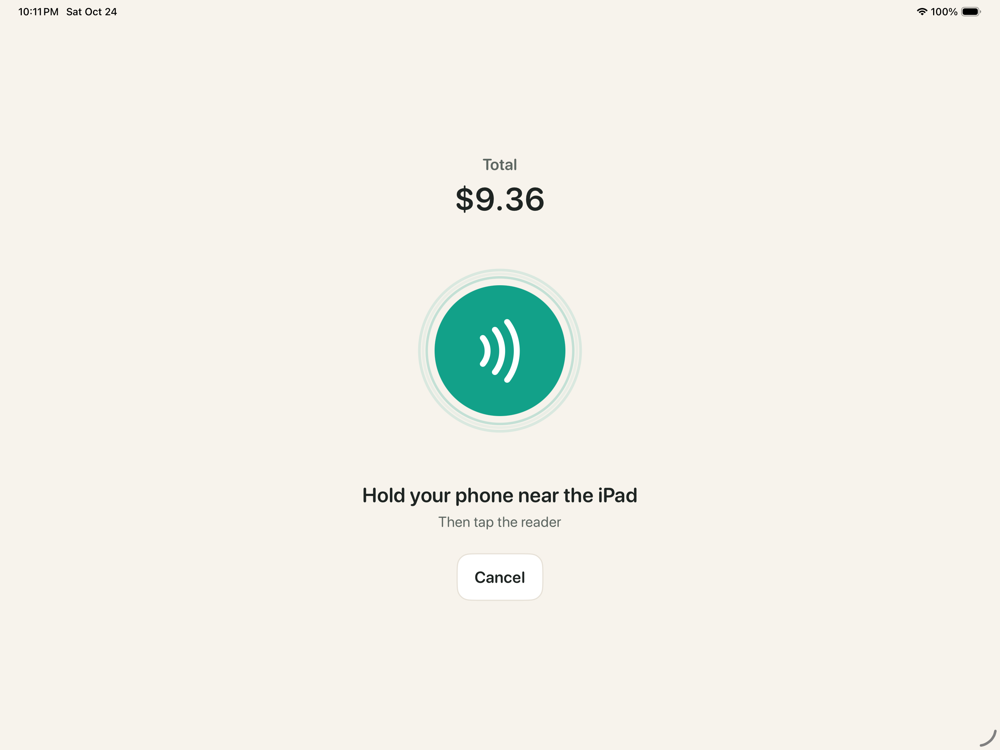<br/><sub>The demo checkout terminal (iPad simulator). The payment provider is simulated.</sub></p>

## How the cart sees

These frames are the Pi's own debug view from a take filmed in a store on 2026-10-25, with the cart running its single overhead camera (the demo configuration; the outline is in [`hardware/roi.json`](hardware/roi.json)). The yellow line is the floor outline the camera watches; the inset is exactly what the cart used to decide.

| Added, named by Claude (0.93) | Added, a tall item (0.93) | Removed, matched by where it was (0.99) |
| :--- | :--- | :--- |
| 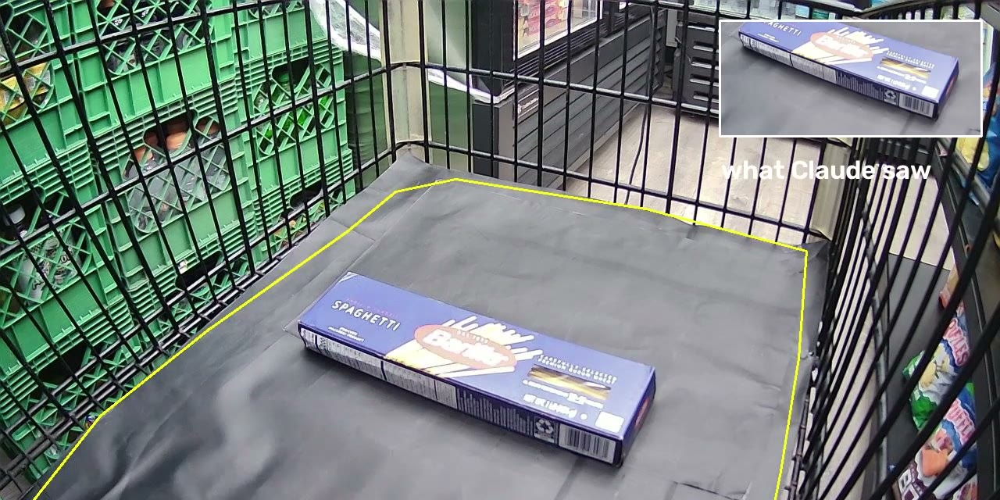 | 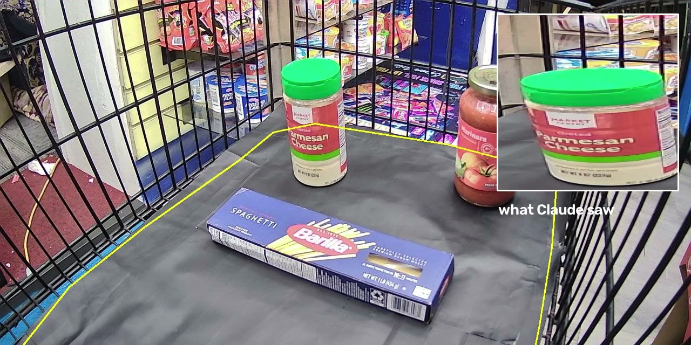 | 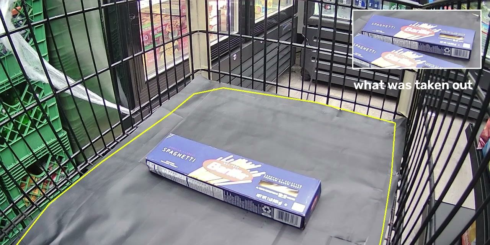 |

How one decision is made, in [`pi/kartcv/`](pi/kartcv/):

1. **Watch, then wait.** Cheap frame differencing runs every tick (`motion.py`). Nothing is judged while a hand is in the basket: the cart waits for motion to stop for `settle_s` (1 s), and a change that touches the frame edge, such as an arm or a tall item, gets an extra `intrusion_recheck_s` (3 s) stillness check.
2. **Diff the settled frame against the last one.** `changes.py` compares only the floor inside the outline (`roi.py`), so shoppers walking past the mesh, the cart rolling and shelves going by are ignored. Each changed region becomes a blob: something new (an add) or something gone (a removal).
3. **Name what was added.** `identify/hybrid.py` tries the enrollment gallery first (`gallery.py`, about five photos per product, roughly a minute each to take). The cart accepts its own guess only above `local_min_score` 0.70 with a `local_min_margin` 0.08 lead. Otherwise the crop goes to `claude-haiku-5-5` (`cloud.py`) together with the catalog's names and per-product `vision_hint` text, and Claude must pick from that list or say it's unsure. Below `cloud_min_conf` 0.6 the item is billed as unknown and the iPad asks "Is this…?".
4. **Attribute removals by place, not look.** `cart.py` remembers where every billed unit sits. A blob that disappears is matched first by its footprint against those positions, then by appearance, so taking out one of two identical boxes removes exactly one.
5. **Bill each placement once.** Two views of the same placement, a late recheck, or an item settling or slumping never adds a second unit, and a box nudged by a newly placed identical box is never read as removed (`decide.py`). One event per unit goes to Supabase with an idempotent `event_id` (see [Architecture](#architecture)).

**Known limits, observed on the real cart.** The baseline is a picture of the floor, so big lighting changes with items inside, such as rolling the cart from an aisle to a bright cooler, can make billed items look new or gone. A jar set down touching a box can be read as one blob. A box stacked exactly on an identical box reads as the first one settling. The stacked case is pinned by the `count-exact-stack` clip in [`pi/tests/clips/`](pi/tests/clips/); the lighting and touching cases are next, from this footage. In every case the shopper can fix the bill by voice or with a tap.

## Architecture

KART runs as six runtimes: CV on the Pi, Postgres functions in Supabase, a Deno Edge Function, the iPad app, the voice agent on Cartesia's hosting, and the merchant console. Supabase is the only shared state. **The Pi never talks to the iPad, and the voice agent never talks to the Pi**: each writes through the same RPCs and reads the same `carts` row. The Cartesia WebSocket between the iPad and the voice agent is the one direct link; it carries audio and change notifications, while the cart itself is always read from the database.

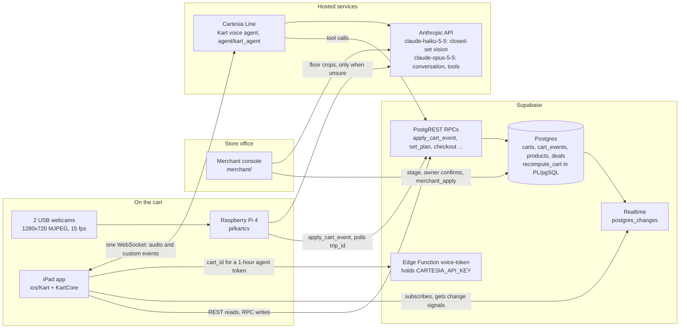

The rules that make this hold together, all from [`docs/CONTRACT.md`](docs/CONTRACT.md):

- **Writers only call RPCs.** Row-level security lets anyone read, and direct table writes are revoked from `anon` ([`backend/db/01_schema.sql`](backend/db/01_schema.sql)). Every change goes through a `SECURITY DEFINER` function that ends in `recompute_cart`.
- **Clients never compute money or routes.** The iPad renders `carts.total`, `savings`, `plan`, `next_step`, `suggestion` and `nudge` as the database wrote them. The Pi sends a product id, never a price.
- **A new trip is a database fact.** `reset_cart` issues a new `carts.trip_id`; the Pi polls it every 2 s and clears its own memory ([`pi/kartcv/trip.py`](pi/kartcv/trip.py)), so the iPad never needs a network path to the Pi.
- **Keys stay off the cart.** The Pi and the iPad hold only the public anon key. The Cartesia key lives in an Edge Function secret, and the iPad gets a one-hour agent-scoped token.
- **Claude proposes, Postgres decides.** The vision model can only answer with a catalog id or `"unknown"`. The merchant agent can only stage a change for the owner to confirm. The voice agent reads every price it says from a tool result or the live cart.

### From a dropped box to Kart's voice

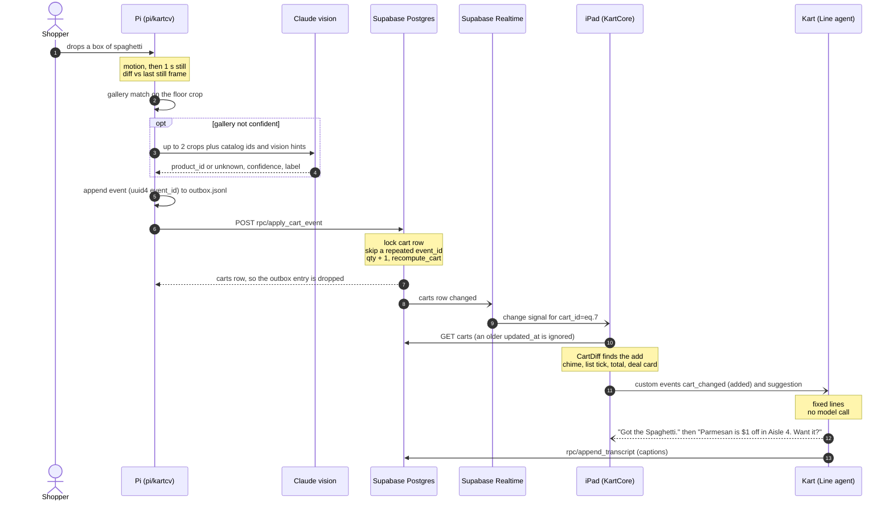

### End-to-end flow, by module

1. **Watch.** [`pi/kartcv/pipeline.py`](pi/kartcv/pipeline.py) runs motion detection on downscaled frames ([`motion.py`](pi/kartcv/motion.py)). When the basket has been still for `settle_s` (1.0 s), [`changes.py`](pi/kartcv/changes.py) diffs each camera against its last settled frame inside the basket-floor polygon ([`roi.py`](pi/kartcv/roi.py)), and [`decide.py`](pi/kartcv/decide.py) turns blobs into one added or removed decision per physical unit across both cameras.
2. **Identify.** [`identify/hybrid.py`](pi/kartcv/identify/hybrid.py) accepts the few-shot gallery's answer when its score is at least 0.70 with a 0.08 margin. Otherwise [`identify/cloud.py`](pi/kartcv/identify/cloud.py) asks Claude with a JSON schema whose `product_id` is an `enum` of live catalog ids plus `"unknown"`. A failure, a timeout (6 s) or confidence under 0.6 becomes an unknown, not a guess. Judging runs on its own worker thread, so the cameras keep being watched while Claude answers.
3. **Deliver.** [`pi/kartcv/sinks.py`](pi/kartcv/sinks.py) writes every event to a local JSONL log and to a persistent outbox, then posts them to `apply_cart_event` strictly in order, with 1 → 30 s backoff.
4. **Apply.** [`backend/db/02_cart.sql`](backend/db/02_cart.sql) records the event, updates `items`, and calls `recompute_cart`, which derives prices, totals, savings, route order, `next_step`, the deal `suggestion`, the quantity `nudge` and the budget in one transaction.
5. **Fan out.** Supabase Realtime publishes `carts`, `cart_events`, `products`, `deals`, `sections`, `transcript` and `receipts`. On the iPad, [`RealtimeSignals.swift`](ios/KartCore/Sources/KartSupabase/RealtimeSignals.swift) turns each message into a refetch in [`SupabaseKartBackend.swift`](ios/KartCore/Sources/KartSupabase/SupabaseKartBackend.swift), which falls back to polling every 5 s while realtime is down.
6. **React.** [`CartDiff.swift`](ios/KartCore/Sources/KartCore/Logic/CartDiff.swift) compares the old and new rows; the app plays a chime, updates cards, and [`LineVoiceSession.swift`](ios/KartCore/Sources/KartCore/Voice/LineVoiceSession.swift) sends `cart_changed`, `suggestion` or `nudge` to the agent as Line custom events.
7. **Speak.** [`agent/kart_agent/agent.py`](agent/kart_agent/agent.py) speaks cart-initiated lines from templates in [`lines.py`](agent/kart_agent/lines.py). Open-ended speech goes to Claude ([`brain.py`](agent/kart_agent/brain.py), [`llm.py`](agent/kart_agent/llm.py)) with the typed store tools in [`tools.py`](agent/kart_agent/tools.py), which write back through the same RPCs.
8. **Close the trip.** Pay calls `checkout()`, which refuses while an unknown item is unresolved and writes one receipt per trip ([`04_trip.sql`](backend/db/04_trip.sql)). The next shopper's Welcome tap calls `reset_cart`, and the Pi's [`TripWatcher`](pi/kartcv/trip.py) sees the new `trip_id`.

The merchant path joins at step 4: a confirmed change in the console runs `merchant_apply`, and statement-level triggers on `products`, `deals` and `sections` recompute every cart, so a new deal reaches a cart already holding its pairing item. [`docs/ARCHITECTURE.md`](docs/ARCHITECTURE.md) covers the data model, every RPC, the event formats, state machines and failure handling.

## Interesting engineering

### Billing each item exactly once over a phone hotspot

- **Problem.** The Pi reaches the internet through a laptop or phone hotspot that drops: the team's logs record hotspot drops and a 20-minute power outage on the cart ([`docs/EDGE_CASES.md`](docs/EDGE_CASES.md), [`docs/STATUS.md`](docs/STATUS.md)). A POST can time out after the server has committed, and an add must never be retried into a double charge or applied after its own removal.
- **Approach.** Each unit gets a uuid4 `event_id` when it is decided ([`pi/kartcv/events.py`](pi/kartcv/events.py)). `HttpSink` appends the event to `pi/state/outbox.jsonl` before sending, flushes strictly in order on a background thread, never holds its lock across network I/O, and backs off 1, 2, 4 … 30 s ([`pi/kartcv/sinks.py`](pi/kartcv/sinks.py)). On the server, `cart_events.event_id` is `unique`, and `apply_cart_event` locks the cart row (`select … for update`) and returns the cart unchanged when it has already seen the id.
- **Why.** At-least-once delivery plus an idempotent apply gives once-only billing without a distributed transaction. Ordering matters because a removal that arrives before its add is a no-op.
- **Tradeoff.** The outbox is head-of-line blocking: an event the server keeps rejecting stalls everything behind it. The RPC is deliberately lenient about `source` and `method` so a client typo can't wedge the queue, but there is no dead-letter path. While offline, the iPad's bill lags the basket until the outbox drains.

### One brain in the database, many thin clients

- **Problem.** Four writers (the Pi, the iPad, the voice agent, the merchant console) and three readers need the same total, route, deal card and nudge. Any client-side math drifts the moment a price changes mid-trip.
- **Approach.** All derived state comes from one PL/pgSQL function, `recompute_cart` ([`backend/db/02_cart.sql`](backend/db/02_cart.sql)): "the price you saw is the price you pay" (a line takes the current price only when it's lower), nearest-aisle route ordering, deal suggestions offered once per trip and replaced when the store creates a newer deal, `deals_quiet`, quantity nudges and the budget. Statement-level triggers on the catalog tables recompute every cart. Clients treat realtime messages as signals and refetch the row over REST, discarding any response older than the `updated_at` they already show.
- **Why.** Every rule has one implementation, tested with pytest against a throwaway Postgres ([`backend/tests/`](backend/tests/)), and the clients stay renderers. A missed realtime message costs one refetch instead of a corrupt local state. Measured on the hosted project, a confirmed merchant change reached the `carts` row about 0.1 s after Confirm ([`merchant/README.md`](merchant/README.md)).
- **Tradeoff.** The cart logic is about 800 lines of PL/pgSQL, which is harder to read and debug than application code. `recompute_all_carts` loops over every cart on each catalog write, which is fine for one demo store and wrong for a chain. The write RPCs are anon-callable with no per-cart authorization, so anyone holding the anon key can edit any cart: acceptable for a hackathon demo, not for production.

### Identifying products without training a model

- **Problem.** The catalog changes while the store is open (the owner adds a product from the console), a trained detector would need new data and retraining for each change, and detection has to fit on a Raspberry Pi 4.
- **Approach.** Detection is classical: snapshot diffs after the basket settles, per-camera basket-floor polygons, a colour-and-texture test that rejects light and shadow, and edge-touching changes held as arms until they stay still for 3 s. Identification is hybrid: about five enrollment photos per product ([`tools/enroll.py`](tools/enroll.py)) feed an on-device nearest-neighbour gallery ([`identify/gallery.py`](pi/kartcv/identify/gallery.py), colour histograms by default, ONNX MobileNetV2 opt-in), and Claude handles the rest as a closed-set choice over the live catalog, guided by each product's one-line `vision_hint` ([`identify/cloud.py`](pi/kartcv/identify/cloud.py)). The Pi refetches the catalog from the `product_catalog` view at startup and on every new trip. Only floor crops, with everything outside the basket painted out, leave the cart.
- **Why.** A product added live with a `vision_hint` can be identified on the next trip with no photos and no retraining, and a schema-constrained answer can't name a product the store doesn't sell. The failure mode is a question on the iPad, not a wrong charge.
- **Tradeoff.** The Claude path needs a network connection and adds latency: a median of 1.6 s on printed-name test crops, which is an upper bound; the real-prop accuracy and latency figures are still blank in [`docs/PITCH_NOTES.md`](docs/PITCH_NOTES.md). Histogram matching confuses look-alike packaging. Geometry has known limits: an identical box stacked exactly on another reads as the first one settling, and touching items can merge into one detection.

### Claude for language, templates for facts

- **Problem.** A cart's voice has to answer in about two seconds on a loud floor, survive chatter without being cut off, and never invent a price, aisle or stock count.
- **Approach.** The agent runs on Cartesia Line; the iPad streams 16 kHz PCM over one WebSocket with a token from the `voice-token` Edge Function. Open speech goes to Claude (`claude-opus-5-5` at low effort, streamed, at most six tool rounds) with typed tools that read and write the live backend ([`agent/kart_agent/tools.py`](agent/kart_agent/tools.py)). Everything the cart initiates is a fixed line filled from database rows and sent uninterruptible: the deal offer ("Parmesan is $1 off in Aisle 4. Want it?") is formatted in SQL by `recompute_cart` and spoken verbatim, and "Got the Spaghetti.", nudges and "Paid. Enjoy pasta night!" come from [`lines.py`](agent/kart_agent/lines.py). A plain yes or no to an open deal is parsed without a model call, and speech not meant for Kart gets a `<quiet>` answer: no reply and no caption.
- **Why.** Templates skip the model round trip and can't hallucinate. Claude is used where templates can't reach: planning a meal with quantities, list edits, diet constraints, and "not sold here" answers. Measured on device, Kart's first words arrive about 1.5–2 s after the shopper stops talking ([`agent/README_CARTESIA.md`](agent/README_CARTESIA.md)).
- **Tradeoff.** Fixed lines are English-only and rigid. Line exposes no voice-activity settings, so a busy aisle can still trigger a reply; hold-to-talk and `KART_BARGE_IN=off` are the mitigations. Cartesia ends Line SDK hosting on December 1, 2026; the migration path to Managed Agents is written up but not done.

## Technology stack

| Layer | Technology | Where |
| :--- | :--- | :--- |
| Edge vision | Python 3.13 on Debian 13 (trixie), OpenCV 4.10, NumPy, optional ONNX Runtime; Anthropic SDK for the closed-set fallback | [`pi/`](pi/), [`tools/`](tools/) |
| Cart hardware | Raspberry Pi 4 (3.7 GB), Logitech Brio 101 plus a wide-angle USB webcam, systemd autostart, 20,000 mAh USB-C bank, Fusion 360 iPad mount | [`hardware/`](hardware/) |
| Database and API | Supabase: Postgres with PL/pgSQL RPCs, row-level security, PostgREST, Realtime | [`backend/db/`](backend/db/) |
| Serverless | Supabase Edge Function in Deno/TypeScript (`voice-token`) | [`backend/supabase/functions/`](backend/supabase/functions/) |
| iPad app | SwiftUI on iPadOS 26, Swift 6.2 package `KartCore` (models and rules) and `KartSupabase` (REST and a Phoenix realtime client over `URLSessionWebSocketTask`), XcodeGen | [`ios/`](ios/) |
| Voice | Cartesia Line (`cartesia-line` 0.2.19) hosting a Python agent; Claude via the `anthropic` SDK with streaming and server-side fallbacks | [`agent/`](agent/) |
| Merchant console | FastAPI, psycopg 3, a single static HTML page, Claude with typed tools | [`merchant/`](merchant/) |
| Tests | pytest (CV, backend, merchant, agent), Swift Testing (KartCore), Deno test (Edge Function), XCUITest rehearsals | each component's `tests/` |

## Getting started

### Prerequisites

- macOS with Xcode 26 (Swift 6.2, iPadOS 26 simulator) and XcodeGen (`brew install xcodegen`) for the iPad app.
- Python 3.12 or newer for `pi/`, `backend/`, `merchant/` and `agent/` (each has its own virtualenv).
- For the whole system: the Supabase CLI with a Docker runtime (the team used colima) for a local stack, or a hosted Supabase project. Deno for the Edge Function tests.
- Keys, only for live mode: Anthropic (vision fallback, voice agent, merchant console) and Cartesia (voice). Without them, each component has an offline mode or test fakes.

### Quick start: the iPad app with no keys (about 5 minutes)

```bash
git clone https://github.com/b0t0001/kart.git && cd kart
cp ios/Config.example.xcconfig ios/Config.xcconfig     # empty values = built-in mock backend
cd ios && xcodegen generate && open Kart.xcodeproj      # run the Kart scheme on an iPad simulator
```

Launch with `-KartDebugButton YES` for a corner button that opens the demo controls (on a device, a three-finger long press does the same). From there you can play the shopper's lines into the scripted mock agent, add or remove any product exactly as the Pi would, and create the Parmesan deal live. [`ios/README.md`](ios/README.md) has a two-minute rehearsal.

The logic tests need nothing else:

```bash
cd ios/KartCore && swift test
```

And the CV pipeline runs on a Mac against synthetic two-camera scenes and recorded clips, with no camera or key:

```bash
python3.12 -m venv pi/.venv && pi/.venv/bin/pip install -r pi/requirements.txt
pi/.venv/bin/python tools/fetch_model.py          # optional ONNX feature model
pi/.venv/bin/python -m pytest pi/tests -q
```

### Full system on one Mac

[`docs/TESTING.md`](docs/TESTING.md) ("Rung 2") is the tested recipe. In short:

1. Start a local Supabase stack (`supabase start --workdir backend`) and copy its URL, anon key and DB URL into `.env` at the repo root (template: [`.env.example`](.env.example); the local stack is described in [`backend/docs/LOCAL_SUPABASE.md`](backend/docs/LOCAL_SUPABASE.md)).
2. Apply the schema and seed the catalog:
   ```bash
   python3 -m venv backend/.venv && backend/.venv/bin/pip install -r backend/requirements.txt
   backend/.venv/bin/python backend/db.py apply      # backend/db/NN_*.sql in order
   backend/.venv/bin/python backend/db.py seed       # data/store.json into the catalog
   ```
3. Point the iPad app at it with `ios/scripts/make-config.sh`, regenerate, and run it in the simulator.
4. Drive the cart from the laptop in place of the cameras:
   ```bash
   P=backend/.venv/bin/python
   $P backend/cart.py reset && $P backend/cart.py plan pasta
   $P backend/cart.py add barilla-spaghetti           # total updates; the Parmesan card pops
   $P backend/cart.py deal kirkland-parmesan 3        # a live store deal reaches the cart
   $P backend/cart.py remove barilla-spaghetti
   ```
5. Optional: the merchant console (`merchant/.venv/bin/python merchant/server.py`, then http://localhost:8090; its chat needs `ANTHROPIC_API_KEY`).

### On the real cart and hosted services

| Step | Command | Guide |
| :--- | :--- | :--- |
| Hosted Supabase: migrate, seed, deploy, simulate, end-to-end, reset | `backend/go_live.sh` | [`backend/README.md`](backend/README.md) |
| Edge Function and its Cartesia secret | `backend/deploy_functions.sh` | [`backend/README.md`](backend/README.md) |
| Voice agent on Cartesia Line (you run it: it signs in and accepts Cartesia's terms) | `agent/scripts/deploy-line.sh` | [`agent/README.md`](agent/README.md) |
| Pi setup and autostart | `hardware/setup_pi.sh`, `hardware/install_service.sh` | [`hardware/README.md`](hardware/README.md) |
| Camera floor outlines and product enrollment | `tools/roi.py`, `tools/enroll.py <product-id>`, `tools/gallery_check.py` | [`pi/README.md`](pi/README.md) |
| Before each judging group (operator only; affects everyone on the database) | `backend/pre_judging.sh [--members]` | [`backend/docs/DEMO.md`](backend/docs/DEMO.md) |

## Configuration

All components read one shared, gitignored `.env` at the repo root (or the file named by `KART_ENV_FILE`). [`.env.example`](.env.example) lists every name; each component also has its own subset.

| Variable | Read by | Notes |
| :--- | :--- | :--- |
| `SUPABASE_URL`, `SUPABASE_ANON_KEY` | Pi, voice agent, iPad (via `make-config.sh`), backend scripts | The anon key is public by design and is the only Supabase credential on the cart |
| `SUPABASE_DB_URL` | `backend/db.py`, `backend/members.py`, `merchant/server.py`, `backend/e2e` | Postgres connection string; laptops only |
| `SUPABASE_SERVICE_ROLE_KEY` | `backend/go_live.sh` | Admin; never on the Pi or the iPad |
| `SUPABASE_PROJECT_REF`, `SUPABASE_ACCESS_TOKEN` | `backend/deploy_functions.sh` | The access token is account-wide; revoke it after use |
| `ANTHROPIC_API_KEY` | Pi (vision fallback), voice agent (set in Cartesia's env), merchant console | Without it the Pi runs gallery-only and logs `local-only mode` |
| `CARTESIA_API_KEY`, `CARTESIA_AGENT_ID` | `voice-token` Edge Function (as function secrets) | The iPad receives only a one-hour token |
| `CART_ID` | Pi, voice agent, merchant console, iPad | The demo cart is `7`; tests use throwaway carts |
| `KART_MODEL`, `KART_EFFORT`, `KART_BARGE_IN` | voice agent | Model, effort, and whether speech can interrupt Kart |
| `MERCHANT_MODEL`, `MERCHANT_EFFORT`, `STORE_TZ` | merchant console | Optional |

Camera and pipeline tuning (camera paths, floor polygons, thresholds, which camera decides) lives in `pi/config.json`, with every default in [`pi/config.example.json`](pi/config.example.json).

**Feature flags.** New behaviour ships behind a flag, with a git tag to roll back to. Flags live in the `feature_flags` table, and `carts.features` overrides them per cart through the `set_feature` RPC.

| Flag | Default | Rollback | What it gates |
| :--- | :--- | :--- | :--- |
| `quantity_nudges` | on (since contract v0.18) | tag `stable-pre-nudges` | "Keep the extra?" and the single "Before you go" checkout list |
| `quantity_nudges_midtrip` | off | flag | One-at-a-time "you're short" nudges as the shopper passes an aisle |
| `member_memory` | off | tag `stable-pre-memory` | Member sign-in, memories, saved lists, the demo date. Off, `set_member` and `set_demo_date` refuse |
| `claude_count`, `personal_items`, `edge_privacy` (in `pi/config.json`) | off | config | CV betas: Claude counts identical units; personal belongings; edge changes never go to Claude |

## Repository structure

```text
kart/
├── pi/                    Edge CV on the Raspberry Pi (Python, OpenCV)
│   ├── main.py            live | replay | reset (systemd runs `live`)
│   ├── kartcv/            motion → settle → changes → decide → identify → events
│   │   ├── identify/      gallery (few-shot), cloud (Claude closed-set), hybrid policy
│   │   ├── sinks.py       JSONL log and the ordered, persistent HTTP outbox
│   │   └── trip.py        watches carts.trip_id and resets cart memory
│   ├── gallery/           enrollment photos, one folder per product id
│   └── tests/             pytest; tests/clips/ holds real-cart regression clips
├── backend/               Supabase schema, RPCs, deploy and demo scripts
│   ├── db/                01_schema … 07_members.sql: tables, RLS, recompute_cart, RPCs
│   ├── supabase/functions/voice-token/   Edge Function: short-lived Cartesia token
│   ├── db.py, cart.py, members.py         migrate and seed; demo levers; member seed
│   ├── go_live.sh, pre_judging.sh         hosted go-live; operator reset before judging
│   └── tests/, e2e/       pytest on a throwaway Postgres; end to end over REST + realtime
├── ios/                   SwiftUI iPad app (XcodeGen: project.yml)
│   ├── Kart/              screens, design system, avatar, debug panel, audio
│   ├── KartCore/          Swift package: models, rules, mock backend, voice session; KartSupabase
│   ├── KartUITests/       automated rehearsals and screenshots
│   └── scripts/           make-config, rehearse, shoot
├── agent/                 Kart, the voice agent on Cartesia Line (Python)
│   └── kart_agent/        agent (events, turn filters), brain (Claude loop), tools, lines, memory
├── merchant/              store-owner console: FastAPI + Claude typed tools; stage → confirm → undo
├── hardware/              Pi setup, systemd unit, camera checks, iPad mount CAD (cad/)
├── tools/                 enrollment, ROI drawing, recording, Claude smoke tests, video clips
├── data/                  store.json catalog (seed and CV fallback), store layouts, judging stock
├── docs/                  CONTRACT, ARCHITECTURE, DEMO_PLAN, TESTING, STATUS, specs, screenshots
└── project_context/       original scope, parts list and hackathon reference material
```

## Verification and tests

Each component has its own suite; [`docs/TESTING.md`](docs/TESTING.md) lays them out as a six-rung ladder, from automated tests to a full demo rehearsal. Counts below are as recorded at the time of writing, with their dates; the suites have grown since the last full run.

| Suite | Command (from the repo root) | Last recorded result |
| :--- | :--- | :--- |
| iPad logic (`KartCore`, `KartSupabase`) | `cd ios/KartCore && swift test` | 184 tests in 14 suites passed (re-run for this README, 2026-10-25) |
| `voice-token` Edge Function | `deno test -A backend/supabase/functions/voice-token/` | 5 passed (re-run for this README, 2026-10-25) |
| CV, synthetic scenes and real clips | `pi/.venv/bin/python -m pytest pi/tests -q` | 131 tests (status log, 2026-10-24 afternoon); 80 passed on the real Pi earlier that day |
| CV ↔ Supabase end to end | `KART_E2E=1 pi/.venv/bin/python -m pytest pi/tests/test_e2e_supabase.py -q` | 2 passed (2026-10-24) |
| Backend unit (throwaway Postgres on :54329) | `backend/.venv/bin/python -m pytest backend/tests -q` | 53 passed (2026-10-24, ~08:00) |
| Backend end to end (local Supabase) | `backend/.venv/bin/python -m pytest backend/e2e -q` | 5 passed (2026-10-24, ~08:00) |
| Merchant console (fake Claude) | `merchant/.venv/bin/python -m pytest merchant/tests -q` | 42 passed (2026-10-24, ~08:00) |
| Voice agent (fakes for Claude and the backend) | `cd agent && .venv/bin/python -m pytest -q` | 29 passed, 2 skipped (2026-10-24, ~08:00) |
| iPad UI rehearsals (simulator) | `ios/scripts/rehearse.sh` (mock), `ios/scripts/rehearse-live.sh` (local Supabase) | pass, with screenshots in `ios/build/shots/` (not tracked) |

Checks against the real services, run by the team on 2026-10-24 and recorded in [`docs/STATUS.md`](docs/STATUS.md): the merchant agent's `merchant/smoke.py` (19/19 on hosted), the Claude identifier on printed-name crops (12/12, median 1.6 s; `tools/cloud_smoke.py`), and 52 conversation scenarios against the real model ([`docs/EDGE_CASES.md`](docs/EDGE_CASES.md)). Real-cart footage replays as regression tests: every clip in `pi/tests/clips/` with an `expected.json` becomes a test.

## Status and limits

KART is a hackathon prototype that ran end to end on a real cart, not a product. What is known to be missing or weak:

- **CV.** An identical box stacked exactly on another isn't counted (never double-billed); touching items can merge into one detection; tall items bill about 4 s after they settle; a hand resting in the basket for more than 3 s can briefly raise an "Is this…?" card. Accuracy and latency on the real props are not recorded in the repo.
- **Payment.** Simulated. The tap-to-pay screen is a demo terminal that charges nothing.
- **Security.** Demo-grade. The write RPCs are anon-callable with no per-cart authorization, and member sign-in is a member number with no PIN.
- **Scale.** `recompute_all_carts` runs over every cart on each catalog write; one store and a handful of carts were the target.
- **Voice.** English only, cloud only (the screen keeps working by touch when voice is offline), no voice-activity tuning on Line, and Line SDK hosting ends December 1, 2026.
- **Not built.** Photos on confirm cards (crop upload to Storage, contract P9) and the cart LCD. "That's mine" for personal belongings was dropped from scope. The Target Berkeley store layout has placeholder aisles.

The decision logs are in [`docs/STATUS.md`](docs/STATUS.md) and each component's `docs/OVERNIGHT.md`.

## License

[MIT](LICENSE). Copyright (c) 2026 the KART team.
