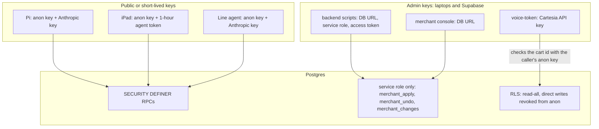
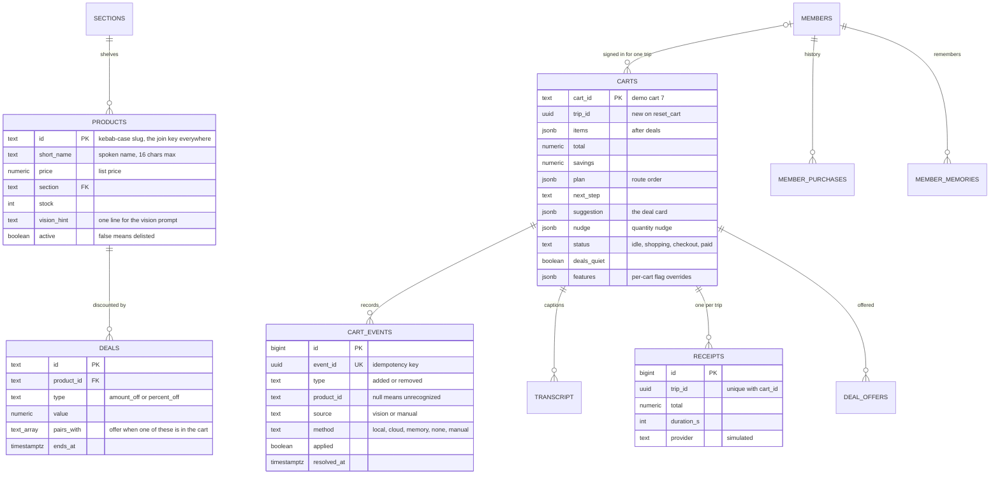
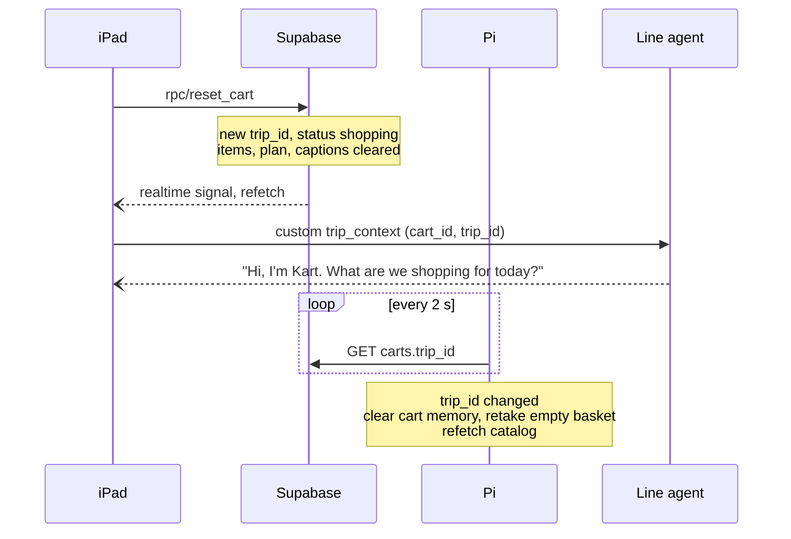
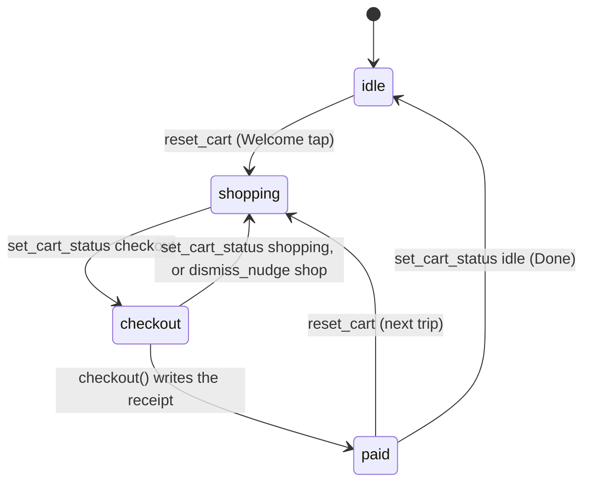
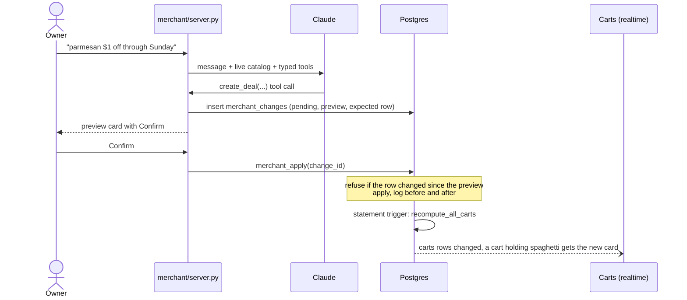

# KART system architecture

This is the deep version of the [README's architecture section](../README.md#architecture): the components and what each one is trusted with, the data model, every RPC, the realtime and event formats, the state machines, and how the system behaves when a piece fails.

**Sources.** [`CONTRACT.md`](CONTRACT.md) is the authoritative integration contract between the workstreams, and wins wherever this page and it disagree. Everything below was checked against the code at the time of writing (2026-10-25): the SQL in [`backend/db/`](../backend/db/), the Pi pipeline in [`pi/kartcv/`](../pi/kartcv/), the iPad packages in [`ios/KartCore/`](../ios/KartCore/), the voice agent in [`agent/kart_agent/`](../agent/kart_agent/) and the console in [`merchant/`](../merchant/).

## Contents

1. [Components and trust](#1-components-and-trust)
2. [Data model](#2-data-model)
3. [RPCs](#3-rpcs)
4. [Derived state: recompute_cart](#4-derived-state-recompute_cart)
5. [Realtime and reads](#5-realtime-and-reads)
6. [Events on the wire](#6-events-on-the-wire)
7. [Lifecycles](#7-lifecycles)
8. [The store-owner path](#8-the-store-owner-path)
9. [Feature flags and rollback](#9-feature-flags-and-rollback)
10. [Failure handling](#10-failure-handling)
11. [Security posture and known gaps](#11-security-posture-and-known-gaps)

## 1. Components and trust

| Component | Runs on | Code | Holds | Talks to |
| :--- | :--- | :--- | :--- | :--- |
| Cart vision | Raspberry Pi 4 on the cart, systemd unit `kart-cv` | [`pi/`](../pi/) | Supabase anon key, Anthropic key | Supabase REST (RPC writes, `carts.trip_id` polls, `product_catalog` reads); Anthropic (crops, only when unsure) |
| Cart database | Supabase Postgres | [`backend/db/`](../backend/db/) | Everything durable | Publishes realtime changes |
| Token function | Supabase Edge Function (Deno) | [`backend/supabase/functions/voice-token/`](../backend/supabase/functions/voice-token/) | Cartesia API key (function secret) | Cartesia token API; reads `carts` to check the cart id |
| iPad app | iPad on the cart handle | [`ios/`](../ios/) | Supabase anon key, a one-hour Cartesia agent token | Supabase REST and Realtime; the token function; the Line agent over one WebSocket |
| Voice agent | Cartesia Line hosting | [`agent/`](../agent/) | Supabase anon key, Anthropic key (set in Cartesia's env) | The iPad (audio and custom events); Supabase RPCs; Anthropic |
| Merchant console | A laptop in the store office | [`merchant/`](../merchant/) | Postgres connection string, Anthropic key | Postgres directly; Anthropic |

The Pi and the iPad have no network path to each other, by design. Everything they share goes through the `carts` row: the Pi writes events, the iPad reads the result, and a new trip reaches the Pi as a new `carts.trip_id` ([`pi/kartcv/trip.py`](../pi/kartcv/trip.py)). The Pi's local `POST :8080/reset` stays as a fallback for an operator on the same network.



## 2. Data model

Schema files run in order: [`01_schema.sql`](../backend/db/01_schema.sql) (tables, realtime, RLS), [`02_cart.sql`](../backend/db/02_cart.sql) (pricing, `recompute_cart`, cart RPCs), [`03_seed.sql`](../backend/db/03_seed.sql) (catalog seed and layouts), [`04_trip.sql`](../backend/db/04_trip.sql) (status, location, captions, checkout), [`05_merchant.sql`](../backend/db/05_merchant.sql) (change log), [`06_analytics.sql`](../backend/db/06_analytics.sql) (anonymous views), [`07_members.sql`](../backend/db/07_members.sql) (member memory beta). Every file is safe to re-run.



Further tables: `store_info` (store size, entrance, active layout, nearby stores), `feature_flags`, `merchant_changes` (service role only) and the member tables, which have row-level security with no anon read and no realtime. Views: `product_catalog` (each active product with its best live deal, `sale_price`, `aisle`, `in_stock`), `live_deals`, and the anonymous analytics views `store_insights` and `deal_performance`.

`data/store.json` is the seed and the Pi's offline fallback catalog. Once the store is live, the `products` and `deals` tables are authoritative ([`CONTRACT.md`](CONTRACT.md) §2).

## 3. RPCs

Writers only call these. Each is `SECURITY DEFINER`, and the cart RPCs return the recomputed `carts` row unless noted.

| RPC | Called by | What it does |
| :--- | :--- | :--- |
| `apply_cart_event(p_cart_id, p_type, p_product_id, p_confidence, p_source, p_label, p_camera, p_snapshot_url, p_event_id, p_method, p_resolves_event_id)` | Pi; iPad (manual fix, + / −) | Records the event; `added` adds a unit, `removed` takes one off. A repeated `p_event_id` is a no-op. A null or unknown product is recorded with `applied = false`. `p_resolves_event_id` marks an unknown add as resolved. |
| `set_plan(p_cart_id, p_plan)` | voice agent | Replaces the list: `[{product_id, reason?, qty?, basis?, meal?}]`; duplicate products merge. |
| `add_to_plan`, `remove_from_plan` | voice agent | Atomic list edits under a row lock. Removing a line also retires its deals for the trip. |
| `set_budget(p_cart_id, p_amount)` | voice agent | "Keep it under $30"; fills `budget_left` and `plan_estimate`. |
| `reset_cart(p_cart_id)` | iPad (Welcome) | New `trip_id`, status `shopping`, empties items, plan, captions, suggestion, nudge, budget and `deals_quiet`. |
| `dismiss_suggestion(p_cart_id, p_quiet default true)` | iPad, voice agent | Clears the deal card. `p_quiet` (a shopper's "No thanks") sets `deals_quiet` for the rest of the trip. |
| `dismiss_nudge(p_cart_id, p_action)` | iPad, voice agent | `keep` raises the plan qty to what's in the cart; `ok` / `skip` close it for the trip; `shop` returns from checkout to shopping. |
| `set_cart_status(p_cart_id, p_status)` | iPad, voice agent | `idle`, `shopping` or `checkout`. `paid` is refused: only `checkout()` sets it. |
| `set_location(p_cart_id, p_section)` | voice agent ("I'm at aisle 5") | Accepts `A5`, `5`, `aisle 5` or a section name. Adds set it too. |
| `append_transcript(p_cart_id, p_role, p_text)` | voice agent | One caption line, tagged with the current trip. Returns the `transcript` row. |
| `checkout(p_cart_id, p_provider)` | iPad (Pay) | Returns the `receipts` row; the same row if called twice in a trip. Raises `unresolved_items` while an unknown add is unresolved. Takes the units off `products.stock`. |
| `set_feature(p_cart_id, p_feature, p_on)` | iPad demo controls | Per-cart flag override; `null` removes it. |
| `set_member`, `set_demo_date`, `member_lookup`, `member_profile`, `member_remember`, `member_save_for_later`, `member_forget` | iPad, voice agent | Member memory beta. `set_member` and `set_demo_date` raise `feature_off: member_memory` unless the flag is on for the cart. |
| `merchant_apply`, `merchant_undo`, `merchant_cancel` | merchant console (service role) | Apply, undo or cancel a staged catalog change (see §8). |

The Edge Function `POST /functions/v1/voice-token {cart_id}` returns `{token, expires_at, agent_id, ws_url, cartesia_version}`, or 400 for an unknown cart and 502 when Cartesia fails ([`handler.ts`](../backend/supabase/functions/voice-token/handler.ts)).

## 4. Derived state: recompute_cart

`recompute_cart(p_cart_id)` in [`02_cart.sql`](../backend/db/02_cart.sql) runs at the end of every cart RPC, and for every cart after any statement on `products`, `deals` or `sections` (statement-level triggers calling `recompute_all_carts`). In order:

1. **Reprice items.** A line takes the current catalog price only when it is lower than the price it already has. Price drops and new deals reach the cart; increases, ended deals and delisted products never raise the bill ("the price you saw is the price you pay", contract P10).
2. **Totals.** `total`, `savings` (list minus paid) and `item_count`.
3. **Location.** `carts.location` (from the last add or "I'm at aisle 5"), else the aisle of the last item added, else the entrance.
4. **Route.** Done plan lines first, then the rest by repeatedly taking the nearest aisle from where the shopper is (ahead wins a tie). This is why the demo route is 6 → 4 → 9 rather than 6 → 9 → 4.
5. **Next step.** The first plan line that isn't in the cart and is in stock (`"Aisle 4 → Parmesan, $1 off"`), or `"All done → Checkout"`.
6. **Suggestion.** A live deal whose `pairs_with` includes something in the cart, on a product that is in stock, not in the cart and not on the plan, offered at most once per trip, and none at all once `deals_quiet` is set. The most recently added pairing wins. A deal the store creates after the current card was offered replaces it. The spoken text ("Parmesan is $1 off in Aisle 4. Want it?") is formatted here, so the voice agent reads it verbatim.
7. **Nudge** (flag `quantity_nudges`). Only plan items. `over` when the cart holds more than the plan's `qty`, with `savings` = the extra units' price; one combined `under` list at checkout. One nudge at a time, never while a deal card is up, at most once per product per direction per trip, and it clears itself when the counts match.
8. **Budget.** `plan_estimate` (the rest of the list at today's sale prices) and `budget_left`.

## 5. Realtime and reads

Realtime is on for `carts`, `cart_events`, `products`, `deals`, `sections`, `transcript` and `receipts` ([`01_schema.sql`](../backend/db/01_schema.sql)). Views don't publish changes, so clients subscribe to the tables and refetch `product_catalog`.

| Client | How it learns about changes |
| :--- | :--- |
| iPad | One Phoenix channel per table ([`RealtimeSignals.swift`](../ios/KartCore/Sources/KartSupabase/RealtimeSignals.swift)). Each message or resubscription is a signal to refetch that slice over REST ([`SupabaseKartBackend.swift`](../ios/KartCore/Sources/KartSupabase/SupabaseKartBackend.swift)). A response with an older `updated_at` than the row on screen is dropped, so a late read can't step the cart back. Until realtime confirms a subscription, it polls every 5 s. |
| Pi | Polls `carts?cart_id=eq.7&select=trip_id` every 2 s and persists the last value, so a trip started while the Pi was off still resets it at boot. Refetches `product_catalog` at startup and on each new trip, falling back to `data/store.json` offline. |
| Voice agent | Reads the cart through the RPCs' return values and its `get_cart` tool, and hears about cart changes from the iPad's custom events (§6). |
| Merchant console | Reads Postgres directly for its live cart, catalog and change-log panels. |

## 6. Events on the wire

### Pi → backend: one event per unit

Every decision becomes one event per physical unit ([`pi/kartcv/events.py`](../pi/kartcv/events.py)), appended to `pi/state/events.jsonl` and to the HTTP outbox:

```json
{"event_id": "uuid4", "cart_id": "7", "type": "added", "product_id": "barilla-spaghetti",
 "confidence": 0.93, "method": "local", "label": "Barilla Spaghetti",
 "cameras": [1], "crops": ["state/crops/<event_id>_cam1.jpg"], "ts": "ISO 8601 UTC",
 "resolves_event_id": null}
```

[`pi/kartcv/sinks.py`](../pi/kartcv/sinks.py) maps it onto `apply_cart_event` with `p_source = "vision"` and `p_camera = cameras[0]`. `method` is `local` (gallery), `cloud` (Claude), `memory` (a removal matched against what the cart remembers) or `none` (unknown). A vision removal of a unit that was billed as unknown carries that add's `event_id` in `resolves_event_id`, so a hand that wandered in and out stops blocking checkout. Crops stay on the Pi.

### iPad ↔ voice agent: Line custom events

The iPad and the agent share one Cartesia Line WebSocket that carries mic audio up, speech down, and JSON custom events both ways ([`LineVoiceSession.swift`](../ios/KartCore/Sources/KartCore/Voice/LineVoiceSession.swift), [`agent/kart_agent/agent.py`](../agent/kart_agent/agent.py)).

| Direction | `type` | Meaning |
| :--- | :--- | :--- |
| iPad → agent | `trip_context` | Cart id, trip id, and member id when signed in. Sent at the start of every call. |
| iPad → agent | `cart_changed` | `added`, `removed` or `price_dropped`, from `CartDiff` on consecutive cart rows. |
| iPad → agent | `suggestion`, `deal_changed`, `nudge` | A new deal card, a store-created deal, a quantity nudge. |
| iPad → agent | `card_response`, `ui_action` | A tapped card button; `checkout_tapped`, `unknown_item`, `paid`. |
| iPad → agent | `reconnected`, `lull`, `member_forgotten`, `member_forget_failed`, `member_idle` | Call recovery and member-beta moments. |
| agent → iPad | `deal_digest`, `digest_deal`, `digest_done` | Kart is walking through deals, so the iPad shows the matching card. |
| agent → iPad | `show_memories` | "What do you know about me?" opens the memory sheet. |

Speaking events are coalesced: an `added` line waits 0.6 s for a paired `suggestion`, so "Got the Spaghetti." and the deal offer arrive as one turn. The same deal or nudge is never spoken twice in a trip.

### Sequence: a new trip



## 7. Lifecycles

### Cart status



`db.py reset-demo` leaves the cart `idle`, which puts the iPad on its Welcome screen. A paid cart always has a receipt, because only `checkout()` can set `paid`.

### An item, from the basket to the bill

1. Motion on downscaled frames; settle after `settle_s` = 1.0 s of stillness ([`motion.py`](../pi/kartcv/motion.py)).
2. Per-camera diff against the last settled frame, inside the floor polygon; light and shadow (low chroma and texture change) are rejected; a camera that shifted wholesale is marked disturbed instead of producing items ([`changes.py`](../pi/kartcv/changes.py)).
3. Each blob is classified as added or removed against the empty-basket picture and cart memory; changes touching the frame edge are held as arms and re-judged after `intrusion_recheck_s` = 3 s ([`decide.py`](../pi/kartcv/decide.py)).
4. The two cameras merge into one decision per unit: a product's count changes by the most units any single camera saw. With `primary_cam` set, a change only the other camera sees waits to join the primary's item, unless it lies in that camera's drawn blind zone.
5. Added units are identified (gallery, then Claude, then unknown); removed units are matched only against what the cart remembers. A same-product add and remove in one settle is a move.
6. The event goes out (§6), the database applies it (§4), and the iPad and Kart react (README sequence diagram).

## 8. The store-owner path

The merchant agent ([`merchant/agent.py`](../merchant/agent.py)) gives Claude typed tools only: `search_products`, `list_deals` and `recent_changes` read; `update_price`, `move_product`, `set_stock`, `add_product`, `create_deal`, `end_deal` and `undo_change` only stage a change with a plain-English preview. The owner's Confirm click is the only path to `merchant_apply`, which is granted to the service role alone.



Undo restores the logged "before" row and refuses if a newer change touched it. Measured against the hosted project at effort `low`: 3.4–6.4 s from the owner's message to the preview, and about 0.1 s from Confirm to the `carts` row ([`merchant/README.md`](../merchant/README.md)).

## 9. Feature flags and rollback

New behaviour ships behind a flag that defaults to off, with a git tag cut on `main` right before the merge, so the team could roll back during the demo without a revert.

| Flag | Where | Default | Rollback point |
| :--- | :--- | :--- | :--- |
| `quantity_nudges` | `feature_flags`; per cart in `carts.features` | on (switched on in contract v0.18 after testing) | tag `stable-pre-nudges`, or the flag |
| `quantity_nudges_midtrip` | `feature_flags` | off | the flag |
| `member_memory` | `feature_flags`; per cart | off | tag `stable-pre-memory` |
| `claude_count`, `personal_items`, `edge_privacy` | `pi/config.json` | off | the config |

With `member_memory` off, `set_member` and `set_demo_date` refuse, so no cart ever has a member, and the backend, agent and iPad behave as they did at `stable-pre-memory` (checked snapshot by snapshot at merge, per the contract). The migration inserts flags with `on conflict do nothing`, so re-running it never flips a default someone changed by hand.

## 10. Failure handling

| Failure | What happens | Where |
| :--- | :--- | :--- |
| Pi loses the network | Events queue in the persistent outbox and are delivered in order when it returns; backoff 1 → 30 s. The bill on the iPad lags until then. | `HttpSink` in [`sinks.py`](../pi/kartcv/sinks.py); `test_outbox_order_backoff_and_restart` |
| A POST times out after the server committed | The retry carries the same `event_id`; the RPC returns the cart without applying it again. | `apply_cart_event`; `backend/tests/test_cart.py::test_repeated_event_id_is_ignored` |
| Claude times out, errors or refuses | `CloudIdentifier.identify` never raises: one quick retry, then an unknown event with the reason in its label. | [`identify/cloud.py`](../pi/kartcv/identify/cloud.py) |
| The camera can't name an item | It's billed as unknown (`applied = false`), the iPad shows "Is this…?", and `checkout()` refuses until it's resolved by a tap or by the item leaving the basket. | `checkout` in [`04_trip.sql`](../backend/db/04_trip.sql); `test_checkout_blocks_on_unresolved_items` |
| The Pi reboots or the power blips | systemd restarts `kart-cv`; cart memory and the last seen `trip_id` are on disk; a trip started meanwhile resets it at boot. | [`hardware/kart-cv.service`](../hardware/kart-cv.service), [`trip.py`](../pi/kartcv/trip.py) |
| A camera is bumped | A wholesale view shift is marked disturbed rather than billed; the operator redraws the floor outline and resets. | [`changes.py`](../pi/kartcv/changes.py), [`hardware/aim_check.py`](../hardware/aim_check.py) |
| A realtime message is lost or arrives late | The iPad refetches on the next signal, polls every 5 s while unsubscribed, and ignores older rows. | `SupabaseKartBackend.swift`; `aLateOlderRefetchNeverStepsTheCartBack` |
| The voice call drops | The iPad retries, then shows "Voice is offline. Tap to retry." and keeps working by touch. A reconnect replays `trip_context` and tells Kart whether the shopper's last turn went unanswered. | `LineVoiceSession.swift`; `aDroppedSocketRetriesThenGoesOffline` |
| The store raises a price or ends a deal mid-trip | Items already in carts keep their price. | `recompute_cart` step 1; `test_price_increase_does_not_raise_the_bill` |
| The owner confirms a stale preview | `merchant_apply` refuses when the row changed after the preview was made. | `merchant_expect` in [`05_merchant.sql`](../backend/db/05_merchant.sql); `test_stale_preview_is_refused` |
| Everything is down at the venue | The iPad's demo controls switch it to the built-in mock backend and scripted voice. | `MockKartBackend.swift`, `DebugPanel.swift` |

## 11. Security posture and known gaps

What holds: secrets never reach the cart beyond the public anon key; the Cartesia key stays in an Edge Function secret; tables can't be written directly; the merchant agent cannot apply anything itself; the vision model can only answer with a catalog id or `"unknown"`; only crops of the basket floor leave the Pi; member tables have no anon read; sensitive product categories are never copied into member history; captions are deleted on `reset_cart`.

What doesn't (demo-grade, by decision):

- **Write RPCs are anon-callable with no per-cart authorization.** Anyone holding the anon key can modify any cart, including `checkout`. Production would need per-device auth and row ownership.
- **Member sign-in is a number with no PIN.** The member RPCs take a member id directly.
- **`recompute_all_carts` is O(carts)** on every catalog statement.
- **Payment is simulated.** `receipts.provider` is `simulated`; the tap-to-pay screen charges nothing.
